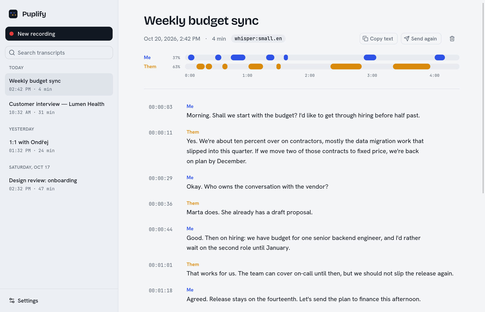

# Puplify

Desktop meeting transcriber for **Linux, macOS and Windows** · [puplify.com](https://puplify.com)

It records your microphone and the meeting's system audio, transcribes both live, and sends the
full text transcript wherever you want: **OneDrive**, **Google Drive**, **Dropbox**, **Notion**, a
**local folder**, or any **webhook** (Zapier, n8n, Make, your own server).



There are no bots joining calls and no AI notes. You get a transcript with a clear "who said what":

```text
Weekly sync
2026-10-20 14:05 – 14:47 (42 min)

[00:00:03] Me: Morning. Shall we start with the budget?
[00:00:07] Them: Yes. We're about ten percent over on contractors.
```

Speakers are told apart by audio source: the microphone is **Me** and system audio is **Them**.
You can rename both labels in Settings. The timeline above each transcript shows both sources as
separate lanes; click any block to jump to that part of the text.

## Features

- **Transcription engines** (choose in Settings)
  - **Local whisper.cpp**: private and offline. A Silero VAD filters out background noise, so it
    doesn't invent text from silence. Text appears a few seconds after each pause.
  - **Deepgram** (Nova-3): cloud streaming with live partial results. Mic and system audio are sent
    as two channels, so speaker labels stay exact.
- **Destinations** receive every finished transcript. You can re-send any stored transcript.
  - OneDrive (personal and work/school accounts): uploads `.txt`, `.md` and/or `.json`.
  - Google Drive: same formats, into a folder in My Drive.
  - Dropbox: same formats, into a Dropbox folder.
  - Notion: one page per transcript under a page you choose.
  - Local folder: same formats, e.g. a synced folder or an Obsidian vault.
  - Webhooks: `recording.started`, live `transcript.segment`, and `recording.completed` with the
    full text. HMAC-signed.
- **Local history**: every transcript is saved as JSON in the data directory and autosaved during
  recording.
- **CLI** (`puplify`): works without the GUI and is scriptable.

## Requirements

| | Linux | macOS | Windows |
|---|---|---|---|
| OS | Any distro with PipeWire (`pipewire-pulse`) or PulseAudio | macOS 13 Ventura or newer, Apple Silicon | Windows 10 or 11, x64 |
| Mic | default or chosen PulseAudio source | CoreAudio input | WASAPI input |
| System audio | monitor of the default output (or any monitor source) | ScreenCaptureKit (needs **Screen & System Audio Recording** permission) | WASAPI loopback of the default (or chosen) output |

## Install

Download from [Releases](https://github.com/jrydel/puplify/releases/latest):

| Platform | File |
|---|---|
| Fedora / RHEL / openSUSE | `Puplify-<version>-1.x86_64.rpm` → `sudo dnf install ./Puplify-*.rpm` |
| Debian / Ubuntu | `Puplify_<version>_amd64.deb` → `sudo apt install ./Puplify_*.deb` |
| Other Linux | `Puplify_<version>_amd64.AppImage` → `chmod +x` and run |
| macOS (Apple Silicon) | `Puplify_<version>_aarch64.dmg` |
| Windows | `Puplify_<version>_x64-setup.exe` (or the `.msi`) |
| CLI only | `puplify-cli-linux-x86_64.tar.gz`, `puplify-cli-macos-arm64.tar.gz`, `puplify-cli-windows-x86_64.zip` |

The macOS build is ad-hoc signed, not notarized. After dragging it to Applications, run
`xattr -dr com.apple.quarantine /Applications/Puplify.app` once. Intel Macs: build from source.
The Windows installer is unsigned, so SmartScreen asks for confirmation (**More info → Run anyway**).

## Build dependencies

Rust ≥ 1.90, Bun or Node (for the Tauri CLI), CMake and a C++ compiler (for whisper.cpp).

Fedora:

```sh
sudo dnf install webkit2gtk4.1-devel libsoup3-devel javascriptcoregtk4.1-devel \
  pulseaudio-libs-devel clang clang-devel cmake gcc-c++ libappindicator-gtk3-devel librsvg2-devel
```

Debian/Ubuntu:

```sh
sudo apt install libwebkit2gtk-4.1-dev libsoup-3.0-dev libjavascriptcoregtk-4.1-dev \
  libpulse-dev clang libclang-dev cmake g++ libayatana-appindicator3-dev librsvg2-dev
```

macOS: Xcode Command Line Tools (`xcode-select --install`) and CMake (`brew install cmake`).

Windows: Visual Studio Build Tools (Desktop development with C++), CMake and LLVM
(`winget install Kitware.CMake LLVM.LLVM`). WebView2 ships with Windows 10/11.

## Build and run

```sh
bun install                 # or: npm install
bun run dev                 # desktop app with hot-reloading UI (Vite on :1420)
bun run build               # bundles: .deb/.rpm/.AppImage, .app/.dmg, or .msi/.exe
cargo build --release -p puplify-cli   # CLI only → target/release/puplify
```

GPU acceleration for whisper.cpp is opt-in: `--features vulkan` or `--features cuda` on Linux and
Windows, e.g. `bun run build -- --features vulkan`. On macOS whisper.cpp already uses Apple's
Accelerate framework; the `metal` feature currently fails to link (missing clang runtime symbol
`___isPlatformVersionAtLeast`), so releases ship without it.

## First run

1. Open **Settings → Transcription**.
   - **Local**: pick a model and click **Download model**. `base.en` (142 MB) is fast on any CPU.
     `small.en` or `large-v3-turbo-q5_0` are more accurate. For other languages, pick a model
     without `.en` and set the language (or `auto`).
   - **Deepgram**: paste an API key from <https://console.deepgram.com>.
2. **Audio**: keep both sources on. Wear headphones if you can; otherwise the mic also picks up the
   other people from your speakers, and their words show up twice (once as Me).
3. **Destinations**: turn on where finished transcripts should go (setup for each below).
4. Click **New recording → Start recording**. The meters show both sources are live. Click
   **Stop** when the meeting ends; the transcript is saved and then sent to every destination.

On macOS the first recording triggers two permission prompts: Microphone, and Screen & System Audio
Recording. After granting the second one, restart the app.

## OneDrive setup

OneDrive access needs a Microsoft Entra app registration. It's free, takes about 3 minutes, and the
app's client ID stays yours:

1. Go to <https://entra.microsoft.com> → **App registrations** → **New registration**.
   - Name: `Puplify`
   - Supported account types: **Accounts in any organizational directory and personal Microsoft
     accounts**. This allows both personal and work/school accounts.
   - Redirect URI: leave empty.
2. Open the new app → **Authentication** → **Advanced settings** → set **Allow public client
   flows** to **Yes** → Save. This is required for device-code sign-in.
3. **API permissions** → Add → Microsoft Graph → Delegated: `Files.ReadWrite`, `User.Read`,
   `offline_access`. In work tenants that need it, an admin must grant consent.
4. Copy the **Application (client) ID** from **Overview**.
5. In the app: **Settings → Destinations → OneDrive** → turn it on, paste the client ID →
   **Connect OneDrive**. A browser page opens; enter the code shown in the app and approve.
6. Choose a folder (default `Transcripts`) and file formats, then **Save changes**.

Files are named `YYYY-MM-DD HHMM Title.txt`. Re-sending replaces the existing file. Tokens are
stored in `onedrive-token.json` in the config directory (mode 0600) and refresh automatically.

Single-tenant only? Put your tenant ID or domain in **Tenant** instead of `common`.

## Google Drive setup

Google Drive access needs your own OAuth client. It's free and takes about 5 minutes. Puplify only
requests the `drive.file` scope, so it can see just the folder and files it creates, never the rest
of your Drive:

1. Go to <https://console.cloud.google.com> and create a project (or pick an existing one).
2. **APIs & Services → Library** → search **Google Drive API** → **Enable**.
3. **APIs & Services → OAuth consent screen** (Google Auth Platform → Branding/Audience): choose
   **External**, fill in the app name and your email, and add your own Google account as a **test
   user**. In *Testing* mode Google expires the sign-in after 7 days; click **Publish app** to avoid
   that (no review is needed for this scope).
4. **APIs & Services → Credentials → Create credentials → OAuth client ID** → Application type
   **TVs and Limited Input devices**.
5. Copy the **Client ID** and **Client secret**. Google requires the secret even for this client
   type; it is stored in `config.json` (mode 0600).
6. In the app: **Settings → Destinations → Google Drive** → turn it on, paste both values →
   **Connect Google Drive**. Enter the code shown on the Google page and approve. From a terminal:
   `puplify gdrive login`.
7. Choose a folder name (default `Transcripts`, created in My Drive on first use) and file formats,
   then **Save changes**.

Files are named `YYYY-MM-DD HHMM Title.txt`. Re-sending updates the existing file instead of adding
a copy. Tokens are stored in `google-drive-token.json` in the config directory (mode 0600) and
refresh automatically.

## Dropbox setup

Dropbox access needs a (free) app in the Dropbox App Console. Sign-in uses PKCE, so there is no
app secret to keep:

1. Go to <https://www.dropbox.com/developers/apps> → **Create app**.
2. Choose **Scoped access**, then **App folder** (Puplify only sees its own folder under
   `Apps/`) or **Full Dropbox**. Name the app.
3. **Permissions** tab: enable `files.content.write` and `account_info.read`, then **Submit**.
4. **Settings** tab: copy the **App key**.
5. In the app: **Settings → Destinations → Dropbox** → turn it on, paste the app key → **Connect
   Dropbox**. Approve on the Dropbox page and paste the code it shows. From a terminal:
   `puplify dropbox login`.
6. Choose a folder (default `/Transcripts`) and file formats, then **Save changes**.

Files are named `YYYY-MM-DD HHMM Title.txt`. Re-sending overwrites the existing file. With an App
folder app, the folder is relative to it. Tokens are stored in `dropbox-token.json` in the config
directory (mode 0600) and refresh automatically.

## Notion setup

Notion uses an internal integration token, so there is no sign-in step:

1. Go to <https://www.notion.so/profile/integrations> → **New integration** → type **Internal**,
   pick your workspace, and save. Copy the **Internal Integration Secret**.
2. Open the Notion page that should hold your transcripts → **⋯ → Connections** → add your
   integration. Without this, Notion answers "object not found".
3. Copy that page's URL (**Share → Copy link**).
4. In the app: **Settings → Destinations → Notion** → turn it on, paste the secret and the page
   URL, then **Save changes**.

Each transcript becomes a sub-page titled with the meeting title, starting with the date and
duration, followed by one paragraph per speaker turn. Re-sending creates a new page.

## Webhooks

Add webhooks in **Settings → Webhooks**; **Send test** posts a sample `recording.completed`.
Every request is a `POST` with a JSON body and these headers:

```text
Content-Type: application/json
X-Puplify-Event: recording.completed
X-Puplify-Delivery: 4f1c…            (unique per delivery)
X-Puplify-Timestamp: 1792505100      (unix seconds)
X-Puplify-Signature: sha256=<hex>    (only when a secret is set)
```

The signature is `HMAC-SHA256(secret, "<timestamp>.<raw body>")`. Check it and reject old
timestamps:

```python
import hmac, hashlib
expected = "sha256=" + hmac.new(secret, f"{ts}.".encode() + body, hashlib.sha256).hexdigest()
ok = hmac.compare_digest(expected, signature_header)
```

Payloads:

```jsonc
// recording.started
{ "event": "recording.started", "delivery_id": "…", "sent_at": "…",
  "transcript": { "id": "…", "title": "…", "started_at": "…", "engine": "whisper:base.en" } }

// transcript.segment  (live, one per finalized utterance; opt-in)
{ "event": "transcript.segment", "transcript_id": "…", "title": "…", "speaker_label": "Me",
  "segment": { "speaker": "me", "start_ms": 3200, "end_ms": 5100, "text": "…" } }

// recording.completed
{ "event": "recording.completed", "duration_ms": 2520000,
  "text": "Weekly sync\n2026-10-20 14:05 – 14:47 (42 min)\n\n[00:00:03] Me: …",
  "transcript": { "id": "…", "title": "…", "started_at": "…", "ended_at": "…", "engine": "…",
                  "labels": { "me": "Me", "them": "Them" }, "segments": [ … ] } }
```

`recording.completed` is retried with backoff (2 s, 8 s) on network errors, 5xx and 429. Live
events are sent once.

## CLI

```text
puplify record [--title T] [--duration SECS]   # Ctrl-C stops
puplify transcribe meeting.wav [--title T]     # any WAV file
puplify list | show <id> [--format txt|md|json] | deliver <id> | delete <id>
puplify devices                                # mic + monitor sources
puplify models list | models download small.en
puplify onedrive login | status | logout
puplify gdrive login | status | logout
puplify dropbox login | status | logout
puplify webhook-test [name]
puplify config                                 # path + current settings
```

## Files

| | Linux | macOS | Windows |
|---|---|---|---|
| Settings (`config.json`, sign-in tokens) | `~/.config/puplify/` | `~/Library/Application Support/puplify/` | `%APPDATA%\puplify\config\` |
| Transcripts, models | `~/.local/share/puplify/` | `~/Library/Application Support/puplify/` | `%APPDATA%\puplify\data\` |

Set `PUPLIFY_HOME=/some/dir` to keep everything in one directory (for portable installs or tests).
`config.json` is plain JSON; the GUI and CLI share it. On Linux and macOS it and the token files are
created with mode 0600.

## Layout

```text
crates/core   capture (audio/), engines (stt/), transcript + store, connectors/, session pipeline
crates/cli    `puplify` command
src-tauri     desktop app (commands in src/main.rs)
ui            React + Tailwind + shadcn/ui front end (Vite; built into dist/)
site          puplify.com landing page (Cloudflare Worker)
```

## Development

```sh
cargo test -p puplify-core
bun run build:ui            # type-check and build the front end
```
